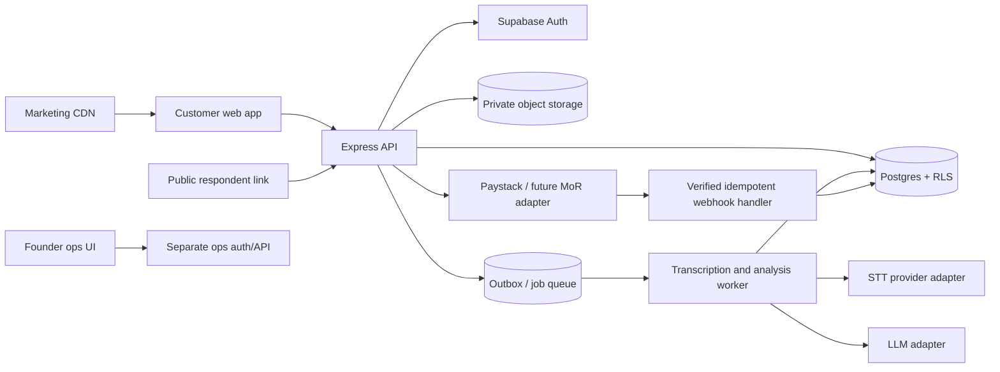

# ConvoSurvey SaaS Migration Plan

**Decision baseline:** 20 October 2026  
**Status:** Audited plan/spec; implementation not started. Current Render service and local response data are to be preserved. Pricing and provider availability are snapshots, not binding quotes.

## Executive Decision

Build ConvoSurvey as a multi-tenant research product in stages, not as an immediate rewrite. Keep the existing Express/vanilla-JS respondent runtime and deploy a separate customer experience and founder operations surface around it. First launch the UX/product research use case with optional voice, English-first, and Nigeria-first payments. Make classic mode available in the pilot so the team can measure whether conversation actually improves results.

**Recommended first architecture:** Supabase Auth + managed Postgres + private Storage, with the existing Express service as the API and a separate static marketing surface. Use Postgres RLS as a database enforcement layer and explicit workspace authorization in Express. Keep platform-operator privileges separate from workspace roles. This is the lowest-complexity route to one relational source of truth, but organization roles and product-specific permissions still belong in Convo’s schema. Validate SSO costs, support, regions, and exact OAuth callback configuration in a non-production project before committing.

**Why not rewrite into a new framework now:** the current respondent runtime, validation, matcher, preview, and export flow are usable foundations. Rewriting all UI and API behavior while introducing identity, billing, tenancy, and audio storage would multiply risk. The major refactor is data ownership/versioning and authentication boundaries, not the conversation widget.

**Hard blockers before production rollout:** the C: drive reports 0 free bytes; local build/install or migration work is blocked until space is freed. The current auth credentials were pasted into chat and must be rotated. Legal business-registration country is still unspecified, so a payment provider cannot yet be finalized. No production secrets have been used by this plan.

## 1. Audit

### Confirmed current state

- **Runtime:** Node.js >=22.13, Express 5, native `node:sqlite`, Multer, vanilla HTML/CSS/JavaScript, optional Groq chat/STT. No frontend build process is defined in [package.json](package.json).
- **Hosting:** Render service `https://convos-fm71.onrender.com` returned 200 for `/`, `/admin`, and `/healthz` in the audit. The repo README recommends a Node host with persistent disk; source does not prove Render disk/env configuration. The app needs persistent `DATA_DIR` for SQLite, `.secret`, and recordings ([README](README.md), [server.js](server.js)).
- **Public surface:** one marketing/home HTML page; its CTA points to `/admin`. Admin shell, survey respondent route `/s/:slug`, and health route are in the same Express service ([public/index.html](public/index.html), [server.js](server.js)).
- **Persistence:** four primary tables: surveys, sessions, messages, answers. Survey config is a JSON blob; sessions snapshot config at start. No `users`, `workspaces`, memberships, roles, published versions, billing, audit events, consent records, webhook delivery, or durable jobs.
- **Auth:** one shared password; signed 7-day cookie; server defaults to `changeme` when `ADMIN_PASSWORD` is missing. All admin accounts would share the same access. No respondent identity is required; a session ID acts as a bearer capability ([server.js](server.js)).
- **AI/audio:** synchronous Groq-compatible chat and transcription calls; browser audio is uploaded to the Express process and buffered in memory; audio is kept on local disk. No durable queue, provider adapter, cost ledger, transcript correction history, or scheduled retention for ordinary responses.
- **Tests:** 7 matcher tests pass. API E2E and mock Groq tests exist; no CI, browser E2E, account, tenant-isolation, billing, migration, restore, or production abuse suite was found. This is source inspection; the E2E was not run.
- **Repository:** `main` tracks `origin/main`, clean at the last check. `.env`, `data/`, and `node_modules/` are ignored. The new audit report remains in [CONVO_PRODUCT_STRATEGY.md](CONVO_PRODUCT_STRATEGY.md).

### Keep / refactor / replace

| Surface | Decision | Rationale |
|---|---|---|
| Conversation runtime, answer validation, matcher | Keep and harden | Valuable existing experience and deterministic write path; add negation, idempotency, and browser tests. |
| Survey configuration stored as mutable JSON | Refactor | Introduce normalized version/field/rule records plus immutable version snapshot; preserve current JSON for legacy read compatibility during migration. |
| Single global admin password | Replace | It cannot safely represent customer accounts, organizations, roles, invitations, or audit ownership. |
| SQLite/local audio | Keep only for legacy/staging; migrate | Single-instance pilot assumption. SaaS requires Postgres, private object storage, backup/restore, and durable processing. |
| One-page home linking to `/admin` | Replace | Public marketing, customer app, and founder operations must be separate surfaces. |
| Existing matcher and API tests | Keep and extend | Add tenancy, auth, version, migration, payment webhook, and browser user-flow gates. |

### Critical correctness/security findings

1. **Cross-tenant access would be catastrophic:** there are no tenant/user foreign keys or ownership predicates today. Do not add sign-up while leaving globally scoped routes reachable.
2. **Live edit can reinterpret history:** sessions snapshot the old form, but stats and CSV headers use the latest mutable config. Pin every response to immutable `form_version_id` and compute results against that version.
3. **Default credential is insecure:** production must fail closed when the admin/platform secret is unset; replace it with individual identity and MFA for platform operations.
4. **Audio/retention consent is incomplete:** generic consent is optional and does not capture provider, modality, retention, disclosure version, or withdrawal. Ordinary sessions/audio have no scheduled expiry.
5. **Synchronous/in-memory work is fragile:** uploads are buffered in memory; follow-up/transcription can block requests; locks/rate counters/pending audio disappear on restart.
6. **Spoken negation needs regression coverage:** matcher may match a mentioned option even when negated (e.g. “not bus”); automatic confidence-based submission must not commit ambiguous polarity.
7. **Summary claims are not evidence-backed today:** model-generated approximate counts can imply prevalence; future counts must be computed deterministically and insights link to response IDs/excerpts.
8. **Runtime warning:** old local logs showed `SQLITE_FULL`; current C: volume has 0 free bytes. Do not run migrations, package installs, or modify the local DB until space and backups are addressed.

## 2. Assumptions and Founder Decisions

### Ranked assumptions

1. Initial buyer is a UX/product research team; first job is customer discovery or product feedback.
2. Global English-first respondent access is desired; voice remains optional and is not marketed as language-accurate before evaluation.
3. Initial platform excludes children’s data, PHI, and other regulated/high-risk research pending legal/ethics review.
4. The business begins Nigeria-first for payment collection but may sell internationally.
5. Classic forms should be generous; monetization targets AI turns, generation, analysis, audio minutes, retained storage, and team/admin features.
6. Respondents are always free and are not account seats.
7. Individuals get a personal workspace; organizations can invite members and hold shared data/billing.
8. Roles are Owner, Admin, Editor, Analyst, Viewer, with different data access.
9. Existing Render instance and response links remain during parallel migration; no data is deleted without a restore-verified cutover.
10. The small team values a managed Auth/DB/storage foundation more than full infrastructure control, subject to cost and data residency confirmation.

### Decisions received

- First market: UX/product research.
- Launch scope: global, English-first.
- Sign-in: email plus Google, Microsoft, Apple, and organization SSO.
- Payments: Nigeria first, expand later.
- Migration: parallel migration; preserve the current Render service and data until cutover.

### Unresolved founder question

**Where is the legal entity that will sell ConvoSurvey incorporated?** “Nigeria first” describes the market, not necessarily the merchant’s country. Paystack/Stripe-network and merchant-of-record onboarding depend on the legal seller, bank settlement, and KYB status. Keep billing behind an adapter until this is answered.

## 3. Architecture and Rejected Alternatives

### System boundaries

- `www.convosurvey.<tld>`: public marketing, templates, help, legal drafts, pricing and public demo. No founder route/link.
- `app.convosurvey.<tld>`: customer workspace, forms, respondents, results, billing and account settings.
- `ops.convosurvey.<tld>`: founder-only operations UI. Separate authorization policy, mandatory MFA, noindex, no public links, generic 404 unless server-side platform-admin check passes.
- `app` API `/api/v1`: customer operations and respondent API; tenant context comes from authenticated membership and is checked at every DB operation.

At first, these can be route/host boundaries in a single Node deployment; do not introduce separate microservices without load/operational justification. The ops service must not depend on a customer workspace role.

### Provider choices

**Auth recommendation: Supabase Auth + app-owned organization membership tables.** This reuses Postgres/RLS for the primary tenant boundary and supports email/password, OAuth providers, MFA, and SAML SSO. The current Supabase pricing page shows Pro from $25/month, 100k included MAU, and SAML SSO pricing/limits; confirm final plan and region before procurement ([pricing](https://supabase.com/pricing), [Google OAuth setup](https://supabase.com/docs/guides/auth/social-login/auth-google), [Microsoft/Azure setup](https://supabase.com/docs/guides/auth/social-login/auth-azure), [Apple setup](https://supabase.com/docs/guides/auth/social-login/auth-apple), [SAML SSO](https://supabase.com/docs/guides/auth/enterprise-sso)). App roles remain in Convo tables; a verified Supabase `sub` plus `workspace_memberships` decides access. Use RLS and application authorization, not either alone.

**Main alternative: Clerk.** It has prebuilt sign-in, organizations, sessions, MFA and SSO; official pricing lists Pro at $20/month annual or $25 monthly with 50k MRU and one SSO connection, while enhanced B2B custom role features cost extra. This is faster for polished SaaS account UX, but adds a separate identity service and custom roles still need careful mapping ([pricing](https://clerk.com/pricing), [organizations](https://clerk.com/docs/organizations/overview)).

**Other evaluated options:** Auth0 supports B2B organizations/SSO but its current official page shows B2B Essentials from $150/month and B2C Essentials from $35/month at base MAU tiers; scope can become costly ([pricing](https://auth0.com/pricing/)). WorkOS AuthKit lists the first 1M MAU free, while SSO connections are priced separately at $125/connection; excellent SSO surface but not the primary application database ([pricing](https://workos.com/pricing), [AuthKit docs](https://workos.com/docs/user-management)). Auth.js is a library rather than a turnkey account/organization service; current docs say the project joined Better Auth, so evaluate migration/maintenance before adopting it ([docs](https://authjs.dev/getting-started)). Firebase supports social login but would add a separate NoSQL data model beside the existing SQL-shaped product; not preferred for this migration ([Google sign-in docs](https://firebase.google.com/docs/auth/web/google-signin)).

### OAuth and SSO setup for founder

Use the Supabase project-specific callback below; the project ref is not yet known, so the exact hostname is a deployment value, not something to guess:

`https://<project-ref>.supabase.co/auth/v1/callback`

- **Google:** Google Cloud → OAuth client ID → Web application. Add production app origin `https://app.<your-domain>` (and local dev origin during testing); set the redirect URI to the Supabase callback; put client ID/secret in Supabase Auth provider settings. Request `openid`, `email`, `profile` only. Google source docs: [Supabase Google setup](https://supabase.com/docs/guides/auth/social-login/auth-google).
- **Microsoft:** Microsoft Entra → App registrations → New registration; choose supported account types for both work/school and personal Microsoft accounts if wanted; add the same Supabase callback as Web redirect; create a client secret; configure provider with client ID/secret and tenant `common`; request `email` scope and review verified-email claim handling. Source: [Supabase Azure setup](https://supabase.com/docs/guides/auth/social-login/auth-azure).
- **Apple:** Apple Developer → create/enable App ID and Sign in with Apple capability; create Services ID; configure website domain `app.<your-domain>` and return URL to the Supabase callback; create Sign in with Apple key and retain the `.p8` securely. Configure Team ID, Key ID, Services ID and generated client secret in Supabase. Apple OAuth client secret must be rotated every six months. Source: [Supabase Apple setup](https://supabase.com/docs/guides/auth/social-login/auth-apple).
- **Enterprise SSO:** configure SAML per organization after an enterprise customer supplies IdP metadata/certificate. Supabase provides a project-specific ACS/Entity ID in its dashboard; use that exact generated value in the customer’s IdP. Do not invent one before creating the connection.
- **Email:** verify a custom domain and configure a transactional sender (Resend or Postmark are candidates; evaluate deliverability, regions, and price); set SPF, DKIM, DMARC. Supabase default SMTP limits are not assumed adequate for public transactional traffic; verify current plan limits.

### Payment provider decision tree

**Provisional Nigeria launch:** Paystack primary for NGN recurring billing and Nigerian cards/bank methods, subject to approved merchant onboarding and subscription product constraints. Its official pricing currently lists local 1.5% + ₦100 (₦100 waived under ₦2,500, fees capped ₦2,000) and international 3.9% + ₦100; international-card settlement is naira by default, with USD settlement described as a public pilot for USD domiciliary accounts ([pricing](https://paystack.com/pricing)). Verify recurring plan support, customer portal/refunds, currencies, and exact seller eligibility in the business’s account.

**Global alternative:** Stripe’s global availability page links Nigeria as an “extended network” via Paystack, not standard direct Stripe onboarding. Paddle’s official page lists 5% + $0.50/checkout and merchant-of-record tax handling, but seller-country eligibility for the still-unspecified legal entity is unverified. Lemon Squeezy lists 5% + $0.50, MoR and global currency support, but verify seller-country onboarding and current program status before selection. Sources: [Stripe availability](https://stripe.com/global), [Paddle pricing](https://www.paddle.com/pricing), [Lemon Squeezy pricing](https://www.lemonsqueezy.com/pricing). **Do not integrate both primary providers in Phase C.** Implement a provider adapter, choose one after KYB, and add a second only for validated regional need. Flutterwave is a fallback candidate with global checkout/API claims and 30+ currencies, but its retrieved pricing page did not expose precise fees or country-specific seller terms ([pricing](https://flutterwave.com/us/pricing)).

### Rejected alternatives

- **Keep shared-password and add `workspace_id` in the UI:** rejected; client filters are not tenant isolation.
- **Make every route a serverless function immediately:** rejected; the current code and request-bound audio flow assume a long-running Express process, SQLite, and local filesystem. First extract stable API contracts and durable storage.
- **Rewrite all frontend and respondent UX before data/auth:** rejected; it increases risk while delaying the tenant boundary.
- **Choose a merchant of record before legal domicile/KYB:** rejected; seller onboarding and payout eligibility are not yet confirmed.

## 4. Data Model, Permission Matrix, and Migration

### Target entities

`profiles (auth.users.id)`, `workspaces`, `workspace_memberships`, `workspace_invites`, `forms`, `form_versions`, `fields`, `logic_rules`, `sessions`, `turns/messages`, `answers`, `audio_assets`, `transcript_versions`, `extractions`, `consent_records`, `insight_runs`, `insight_evidence`, `plans`, `subscriptions`, `usage_ledger`, `api_keys (hashed)`, `integrations`, `webhooks`, `webhook_deliveries`, `audit_log`, and a separate `platform_admins` table.

Every business-owned row includes `workspace_id NOT NULL`; respondent rows link to an immutable `form_version_id`. An answer stores the canonical value, source modality, transcript ID, extraction/correction status, actor and timestamp. Raw transcript/audio are immutable where retained; corrections append a new version. Confidence stays null until calibrated. Keep respondent identity optional and separate from account identity.

**Workspace membership:** unique `(workspace_id, user_id)`; roles enum; invited/active/suspended state; created/accepted/revoked timestamps. **Form version:** immutable JSON snapshot plus normalized fields/rules and published timestamp; edits create another version, never overwrite the version used by a response.

### Permission matrix (proposed)

| Action | Owner | Admin | Editor | Analyst | Viewer |
|---|---|---|---|---|---|
| Create/edit drafts | Yes | Yes | Yes | No | No |
| Publish/close form | Yes | Yes | Yes | No | No |
| Delete form/response | Yes | Yes | No | No | No |
| View response data/audio | Yes | Yes | No by default | Yes | No |
| Export results | Yes | Yes | No | Yes | No |
| Manage members/invites | Yes | Yes | No | No | No |
| Billing/payment method | Yes | No | No | No | No |
| Workspace settings/API keys | Yes | Yes | No | No | No |
| Transfer/delete workspace | Yes, re-auth + audit | No | No | No | No |

This is a product recommendation, not existing authorization. User may belong to many workspaces; all authorization uses `(auth.uid(), workspace_id, role)` and database policy. The founder ops role is never a workspace role.

### Parallel migration and cutover

1. Keep Render live and do not change its DB or URL yet. Produce a SQLite-consistent backup including WAL, copy audio to a protected staging backup, record hashes/counts, and run restore test.
2. Provision staging Postgres/Storage with separate secrets; create additive migrations and RLS first; test on synthetic fixture data.
3. Create a `legacy` workspace. Do not infer historic consent or user emails. A founder account can claim it via a one-time, expiring, audited process after email verification.
4. Convert each existing survey config into a current form version; derive response versions from each session’s saved snapshot, deduplicate equal snapshots by canonical hash, retain original IDs/timestamps. Compare original vs migrated response counts, stats, exports, transcript/audio references.
5. Copy audio as private objects; verify checksums and DB mappings. Do not delete source files until rollback window closes.
6. Shadow-read from the new DB, then controlled cutover with existing `/s/:slug` links preserved. Keep old service/database read-only until restore and reconciliation pass; no destructive schema changes before founder approves.

## 5. Plans and Unit Economics

Classic form fields are included generously; monetize cost drivers, not respondent seats. Proposed tiers remain pricing hypotheses: Free $0 with up to 1,000 classic responses and small AI/voice allowance; Pro about $29/workspace/month; Team about $99/month with included seats; Organization custom. Exact included usage is set only after pilot use and provider charges are measured. Warn at 80%, hard-cap AI/audio spend, preserve answers, and at limit offer classic/typed fallback instead of dropping submissions.

**Provider price basis, checked 20 Oct 2026:** Groq's model page lists `openai/gpt-oss-120b` at $0.15/M input and $0.60/M output tokens; Groq Whisper Large V3 Turbo is listed at $0.04/audio hour, with a 10-second minimum billed length. Sources: [Groq models](https://console.groq.com/docs/models), [Groq speech-to-text](https://console.groq.com/docs/speech-to-text). These are provider API prices only; verify account-specific rate limits, billable model availability and currency.

Illustrative variable API cost per completed response (not an observed measurement):

| Scenario | Assumed chat work | Voice assumption | Model cost | STT cost | Total API-only/response |
|---|---|---|---:|---:|---:|
| Low | 1 call; 1,200 input + 200 output tokens | 10% voice, 2 minutes each | $0.00030 | $0.00013 | $0.00043 |
| Typical | 2 calls; 4,000 input + 500 output total | 40% voice, 4 minutes each | $0.00090 | $0.00107 | $0.00197 |
| Heavy | 5 calls; 20,000 input + 2,000 output total | 75% voice, 8 minutes each | $0.00420 | $0.00400 | $0.00820 |

At 100,000 completed responses, those API-only scenarios are about $43, $197, and $820 respectively. They **exclude** form generation allocation, LLM analysis, storage, egress, email, payment processing, retries, abuse, review labor, tax, and support. Storage is computed from mean compressed audio size × retention days × storage price + egress. For each tier calculate `gross margin = (revenue - all measured COGS) / revenue`; do not claim a margin until storage/retention and real call counts are instrumented. Caps: per-workspace turns, generations, transcription minutes, analysis runs, storage, global/provider budgets and circuit breakers.

## 6. Marketing, Customer App, Founder Ops

### Public marketing pages

Build a small set of real pages, not a 13-page stub: Home with working sample demo; How it works; Features; Voice & AI; Use cases; Templates; Pricing/How we compare; Security/Privacy/Trust; Help/docs; About/Contact; Legal drafts; Sign up/Log in/Forgot/Verify. Add unique metadata/OG, sitemap, canonical URLs and structured data only where accurate. Public CTA must be “Get started free” / “Log in,” never “Open admin dashboard.” Do not claim voice language quality, encryption, residency, compliance or accuracy unless tested and contractually true.

### Customer app

Workspace-aware onboarding, dashboard and usage meter; AI generation from prompt/pasted questions/PDF (PDF import deferred until extraction security/evals); manual builder, preview, history/undo, chat and classic responder modes; consent/voice contract; link/QR/embed; password/invite/date/cap closure; response table/transcript/audio; correction; evidence-backed insights; CSV export first, webhooks next, Sheets/Notion after demand; workspace members, billing and retention settings.

### Founder-only ops

Separate host/origin and separate auth policy, mandatory MFA, short session, optional IP allowlist, `noindex`, no navigation/link from public/app, generic 404 for unauthorized users. Server-side platform-admin DB allowlist only. User/workspace search; plan/credit overrides; revenue/COGS view; abuse queue; suspension; feature flags/kill switches; job/webhook health; immutable audit. Support impersonation deferred; if later added it is read-only by default, time-limited, customer-visible and audited.

## 7. Harness and Security Gates

### Build harness (proportional)

- Add `AGENTS.md`, phase specs/acceptance criteria, ADRs, migration directory, env template with names only, staging/prod separation.
- CI: unit, API integration with fake auth/provider, browser E2E, tenant-isolation tests, migration up/down/restore, dependency audit and secret scan. Do not give implementation agents production credentials. Feature flag each identity, billing, AI and storage cutover.
- Independent reviewer checks auth/RLS/audio/billing diffs; test evidence and rollback notes required. Stop after 3 failing iterations and record blocker rather than loop.

### Product AI harness

Version each prompt/model/provider/schema, log call ID/latency/tokens/cost without raw PII by default, stage/canary/rollback, per-workspace/global caps, durable outbox/jobs, and kill switch. Database/state machine owns consent, field schema, validation, branching and termination; LLM only suggests phrasing/probe/extraction. Model output never writes canonical answers until validation/confirmation.

**40 form briefs:** (1) SaaS churn; (2) first-time onboarding; (3) local delivery; (4) community feedback; (5) public transport; (6) clinic wait time; (7) NPS; (8) concept test; (9) post-event; (10) short event signup/classic recommendation; (11) payment checkout/classic recommendation; (12) consent-only/classic; (13) job application/classic; (14) educator course feedback; (15) employee exit/sensitivity warning; (16) grant intake; (17) product bug report; (18) customer support CSAT; (19) mixed-scale instrument; (20) multi-select barriers; (21) rating labels; (22) optional sensitive field; (23) Nigerian English; (24) Pidgin translation; (25) Yoruba translation; (26) Swahili/code-switch; (27) French; (28) Arabic/RTL support unknown; (29) screen-reader and plain language; (30) low-bandwidth; (31) 30-question burden warning; (32) anonymous-plus-email contradiction; (33) leading “prove us best” request; (34) double-barrel questions; (35) missing objective; (36) existing pasted questions; (37) PDF import; (38) revision preserving IDs; (39) prompt injection requesting system prompt; (40) health diagnosis request.

**Proposed generation gates:** 100% schema/allowlist validation; no unsupported promises; no unsupported field/rule output; zero critical leading/double-barrel failures in human rubric sample; unchanged fields preserve IDs; repair bounded at 3 attempts; quality scored by two independent reviewers. Generation validity and research quality are distinct.

**Conversation evals:** cooperative, vague, hostile, off-topic, refusal, “I don’t know,” negated choice (“not bus”), self-correction, injection, unsupported sensitive topic, provider timeout, retry/double-submit, invalid required answer. Gates: zero invalid canonical answers, zero hidden prompt disclosure, all required refusal/skip behaviors respected, probe count bounded, model timeout preserves accepted answer/state.

**Voice evals:** human-labeled corpus across actual launch language/accent/noise/device groups. Measure WER/CER, named entity and answer extraction accuracy, false auto-accept, p50/p95 latency, user correction rate, cost/audio minute. Minimum thresholds are set before marketing a language; initial proposed gate is <=15% WER and >=95% field correctness only for conditions where the dataset is sufficiently representative. These are proposed targets, not observed capability claims. Unsupported/under-sampled languages show “not evaluated.”

**Analysis evals:** human-coded benchmark with inter-rater agreement; every theme supported by exact response IDs/quotes/timestamps; counts are computed by SQL/code, not generated prose; no invented quotes; sample size/exclusions/model version shown. Sentiment is not a respondent truth label and can be deferred.

## 8. Security, Privacy, DevOps

- Require configured strong secrets; rotate disclosed key/password. Provider secrets only in Render/Supabase secret manager, never repo. Use separate dev/staging/prod project keys and isolated data.
- TLS; encrypted database/storage/backups; least privilege; signed expiring private audio URLs; signed/idempotent webhooks; audit log for membership, billing, exports, audio access, platform operations.
- Explicit study consent plus separate recording/third-party transcription disclosure; store exact disclosure version, selected modes, timestamp and provider. Configurable retention with deletion across audio, transcripts, derived data and backup lifecycle. Avoid claims of anonymity by default.
- Nigeria NDPA 2023/GDPR/CCPA apply only as determined by counsel. Legal drafts are labeled drafts; obtain DPA/subprocessor/transfer review. Do not accept PHI, children’s data, or regulated research in initial launch without legal/ethics/provider review.
- Abuse controls: creator verification as appropriate, report link, bot and rate limits, content rules for password/payment collection, prompt injection protections, upload scanning/content validation, quota caps, and incident path.
- **100 responses:** one app instance, managed Postgres, private object storage, backup/restore drill. **100k:** queue/worker, pagination, shared limits, alerts/cost tracking, load tests. **10m:** partition/warehouse, region strategy, lifecycle storage, dedicated operations/on-call. These are architecture thresholds, not capacity guarantees.
- Respondent low bandwidth: minimal scripts/fonts, no external dependencies in critical path, local text drafts, idempotent retries, compressed/resumable uploads; do not cache audio on shared devices. Queue offline text answers; do not promise offline audio in MVP.
- Render is currently a single web service. Add a paid always-on worker/web service for jobs; Postgres/Storage separate. Before committing to monthly spend, check Render plan/region/persistent disk plus Supabase compute, storage and egress. C drive is currently full; clear space before local build/migration work.

## 9. Phase Plan and Acceptance Criteria

| Phase | Deliverable and acceptance gates | Data safety / rollback |
|---|---|---|
| A: identity + isolation | Supabase staging; email verified/reset; Google/Microsoft/Apple OAuth; MFA; workspace/membership/roles; invite lifecycle; remove public admin link; `ops` generic 404; full role permission tests; two-workspace test proves no cross-read/write/audio/export. | Legacy app remains live; all DB migrations additive; no destructive cutover. |
| B: customer product | Workspace onboarding; classic/chat modes use one schema; builder/versioning; preview; response tables/correction/evidence; no claim of unsupported voice language; usability test publish under 5 minutes. | Legacy route/IDs stay resolvable; version-aware imports/exports compare against old stats. |
| C: billing | Provider adapter; Paystack NGN checkout/subscriptions if merchant approved; plans/entitlements/usage ledger; signed idempotent webhooks; 80% warning; hard caps with classic fallback; customer portal and cancellation. | Sandbox only until legal domicile/KYB; simulate charge/refund/failure/webhook replay. |
| D: AI harness | prompt/model versioning; 40 form briefs; scripted respondent suite; voice corpus; grounded analysis; budgets; worker retry/dead-letter; feature kill switch. | Human review and typed fallback; data persisted before optional AI work. |
| E: public site | required marketing pages and sample demo; links point to customer sign-in only; SEO/accessibility audits; verified dated comparison; legal drafts marked for counsel. | No control-plane route in sitemap, navigation or public content. |
| F: platform ops | isolated ops surface; mandatory MFA; server-side platform-admin authorization; cost/abuse/job/webhook dashboards; audited actions. | No unrestricted support impersonation in first release; no customer data mutation by default. |
| G: launch hardening | security review, OWASP tests, load/slow network/abuse, restore drill, rollback, status/incident runbook, email SPF/DKIM/DMARC, cost alarms. | Separate staging/prod secrets and DB; migration dry-run and restore verified. |

## 10. Decisions Still Needed

1. Confirm exact Nigerian legal entity/country of incorporation and payout bank setup; payment availability is not resolved by “Nigeria first.”
2. Select Supabase Auth only after verifying SSO add-on cost, region/data terms, email deliverability and service-role/RLS setup in a disposable staging project. Clerk is the alternative if faster organization UX is worth added identity-vendor cost.
3. Confirm first launch excludes all sensitive health/child/PHI research.
4. Confirm audio retention default and whether respondents can delete anonymously submitted responses via a receipt/token.
5. Confirm if UX research only is the first template/marketing focus, while NGOs/program monitoring are later.

## Sources checked 20 Oct 2026

- [Supabase pricing](https://supabase.com/pricing), [OAuth Google](https://supabase.com/docs/guides/auth/social-login/auth-google), [OAuth Microsoft](https://supabase.com/docs/guides/auth/social-login/auth-azure), [OAuth Apple](https://supabase.com/docs/guides/auth/social-login/auth-apple), [SAML SSO](https://supabase.com/docs/guides/auth/enterprise-sso)
- [Clerk pricing](https://clerk.com/pricing), [Clerk organizations](https://clerk.com/docs/organizations/overview)
- [Auth0 pricing](https://auth0.com/pricing/), [WorkOS pricing](https://workos.com/pricing), [Auth.js docs](https://authjs.dev/getting-started), [Firebase Auth Google docs](https://firebase.google.com/docs/auth/web/google-signin)
- [Paystack pricing](https://paystack.com/pricing), [Flutterwave pricing](https://flutterwave.com/us/pricing), [Stripe country availability](https://stripe.com/global), [Paddle pricing](https://www.paddle.com/pricing), [Lemon Squeezy pricing](https://www.lemonsqueezy.com/pricing)
- Competitor matrix/review sources: [CONVO_PRODUCT_STRATEGY.md](CONVO_PRODUCT_STRATEGY.md#L71)

**Evidence gaps:** Stripe listing Nigeria via Paystack’s extended network is not the same as direct Stripe Nigeria onboarding; Flutterwave’s retrieved page did not expose exact Nigeria fees; Paddle/Lemon Squeezy eligibility for the actual merchant is unverified; no company country, Supabase project/region, domain, OAuth client, SSO IdP, sender domain, or payment account exists in repo evidence. Do not create paid provider accounts or enable live billing until the founder confirms these.
